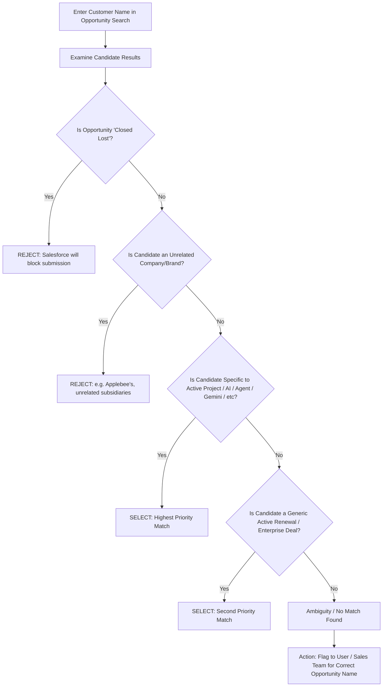
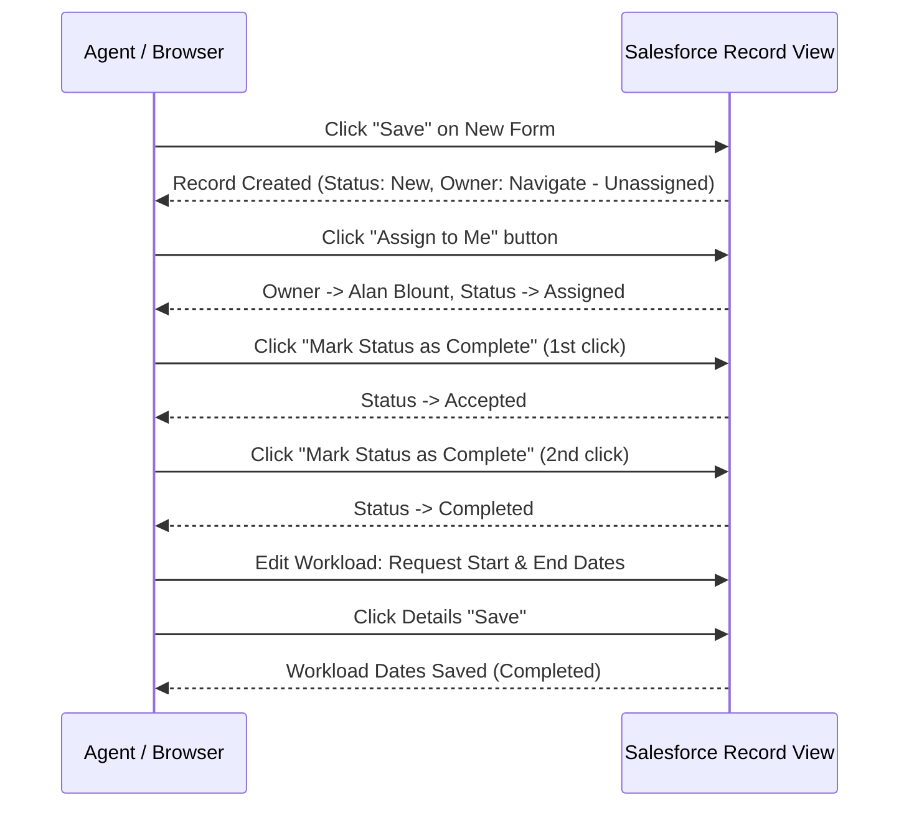

# Skill: OPM Tracking (Salesforce Expert Requests)

Automates the creation, assignment, status advancement, and date logging for customer meeting **Expert Requests** in Salesforce Vector Lightning (`vector.lightning.force.com`).

---

## Quick Reference & URLs

- **SSO Authenication go link**: go/vector
- **New Request Form**: `https://vector.lightning.force.com/lightning/o/Expert_Request__c/new`
- **Expert Requests Home**: `https://vector.lightning.force.com/lightning/o/Expert_Request__c/list`

---

## Standard Field Defaults (Cloud AI OPM)

| Field Name                | Type / Selector            | Standard Value / Default                         | Notes                                                                                 |
| :------------------------ | :------------------------- | :----------------------------------------------- | :------------------------------------------------------------------------------------ |
| **Opportunity Name**      | Lookup / Autocomplete      | _Dynamic per customer_ (see Decision Tree below) | **Required**. Must be an **Open** Opportunity. Avoid Closed Lost.                     |
| **Type of Expertise**     | Combobox (Optional Filter) | `Other SME Teams`                                | Fixed default for Cloud AI OPM.                                                       |
| **Expert Team**           | Combobox                   | `Cloud AI OPM (Global)`                          | Fixed default.                                                                        |
| **Solution / Product**    | Combobox                   | `AI`                                             | Standard default.                                                                     |
| **Engagement Type**       | Combobox                   | `Customer Meetings`                              | Standard default.                                                                     |
| **Description / Purpose** | Textarea                   | `"Agent Platform"`                               | Default fallback; include specific topic (e.g. `A2A`, `AP2`, `Protocol`) if provided. |

---

## Opportunity Resolution & Decision Tree

When entering the customer name into the `*Opportunity Name` search field, a list of candidate opportunities is returned. Follow this evaluation order:

### Opportunity Selection Rules:

1. **Never Select Closed Lost Opportunities**:
   - Salesforce displays a hard validation error: _"The Opportunity you have chosen is set as Closed Lost, please choose an open Opportunity to file an Expert Request."_
2. **Filter Out Unrelated Entities & Sub-brands**:
   - Ignore distinct businesses with substring overlaps (e.g. searching "Apple" returns "Applebee's", "Pineapple Consulting", "British Airways", "Appleton Oil").
   - Differentiate distinct subsidiary domains (e.g. `sales.claris.com`, `dev.acwellness.com`) from main enterprise engagements.
3. **Prefer Agent / Cloud AI / Tech Engagements**:
   - If an opportunity mentions _Agent Assist_, _Agent Platform_, _Cloud AI_, or _Enterprise Generative AI_, choose that match.
4. **Fallback to Broadest Active Renewal/Account**:
   - If no specific AI engagement exists, pick the least specific / broadest active account renewal (e.g. `[Customer Name] - sales.cust.com - 2026 QX renewal`).
5. **Ambiguity Resolution & Escalation**:
   - If no reasonable open opportunity is found, or multiple conflicting active opportunities exist without clear scope:
     - **Do NOT guess blindly**.
     - Flag the customer and request details to Alan or reach out to the account sales team to confirm the appropriate Opportunity Name.

---

## Complete Step-by-Step Lifecycle Workflow

### Phase 1: Form Creation & Submission

1. Navigate to: `https://vector.lightning.force.com/lightning/o/Expert_Request__c/new`
2. **Opportunity Name**:
   - Type customer name (e.g., `Apple`).
   - Select the approved open opportunity from the autocomplete list.
   - Verify that `Account Name` and `Region` / `Sub-Region` populate.
3. **Type of Expertise**: Select `Other SME Teams`.
4. **Expert Team**: Select `Cloud AI OPM (Global)`.
5. **Solution / Product**: Select `AI`.
6. **Engagement Type**: Select `Customer Meetings`.
7. **Description/Purpose**: Enter `"Agent Platform"` (or meeting specific summary).
8. Click **`Save`**.
   - Confirmation toast appears: `Expert Request ER-XXXXXX: Your Request Has Been Successfully Created`.

---

### Phase 2: Post-Creation Lifecycle & Status Completion (Mandatory)

_Saving the form only creates an unassigned draft. You must complete the following 3 actions:_

1. **Assign to Me**:
   - Locate top action header buttons (`Follow`, `Transfer/Edit Request`, `Share Request`, `Assign to Me`, `Edit`, `New Note`).
   - Click **`Assign to Me`**.
   - Verify `Owner` changes from `Navigate - Unassigned` to `Alan Blount` and Status updates to `Assigned`.
2. **Mark Status as Complete (Two-Click Transition)**:
   - Click **`Mark Status as Complete`** in the status banner.
   - Status transitions to `Accepted`.
   - Click **`Mark Status as Complete`** again.
   - Status transitions to `Completed`.
3. **Set Workload Dates (`Request Start Date` & `Request End Date`)**:
   - In the **Details** pane, locate the **Workload** section.
   - Click the pencil edit icon next to `Request Start Date` (or double-click).
   - Enter the meeting date in `M/D/YYYY` format (e.g. `7/29/2026`).
   - Set `Request End Date` to the same meeting date (`M/D/YYYY`).
   - Click **`Save`** at the bottom of the details section.
4. **Proceed to Next Entry**:
   - Navigate to `https://vector.lightning.force.com/lightning/o/Expert_Request__c/new` to process subsequent meetings.

---

## Batch Entry Checklist

When processing a list of customer meetings:

- [ ] Customer Name & Target Date verified.
- [ ] Active / Open Opportunity identified.
- [ ] Record created with `Cloud AI OPM (Global)` + `AI` + `Customer Meetings`.
- [ ] `Assign to Me` clicked.
- [ ] Status advanced through `Accepted` -> `Completed`.
- [ ] `Request Start Date` and `Request End Date` populated and saved.
- [ ] Record ID (`ER-XXXXXX`) logged in summary table.
